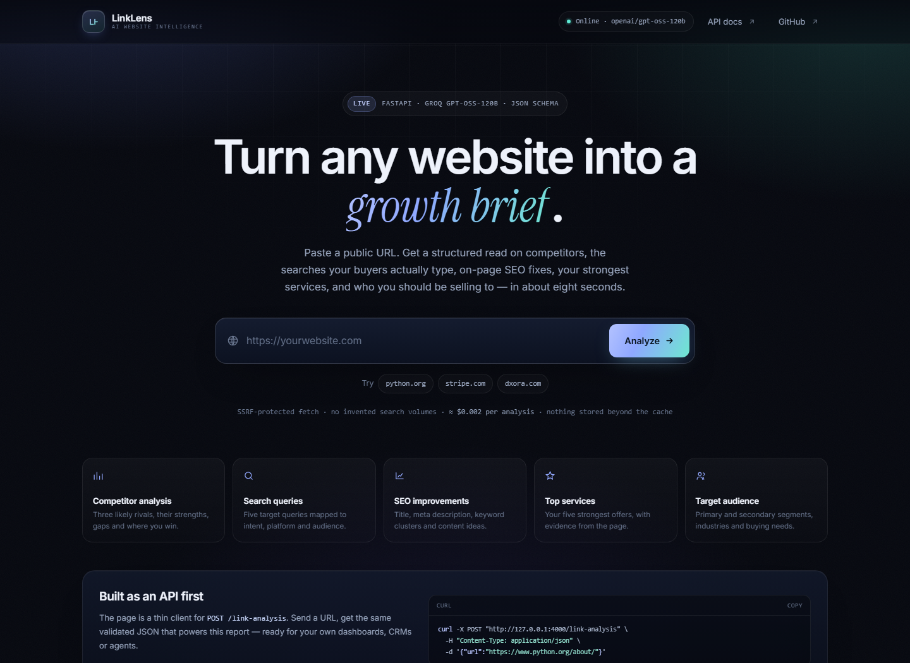
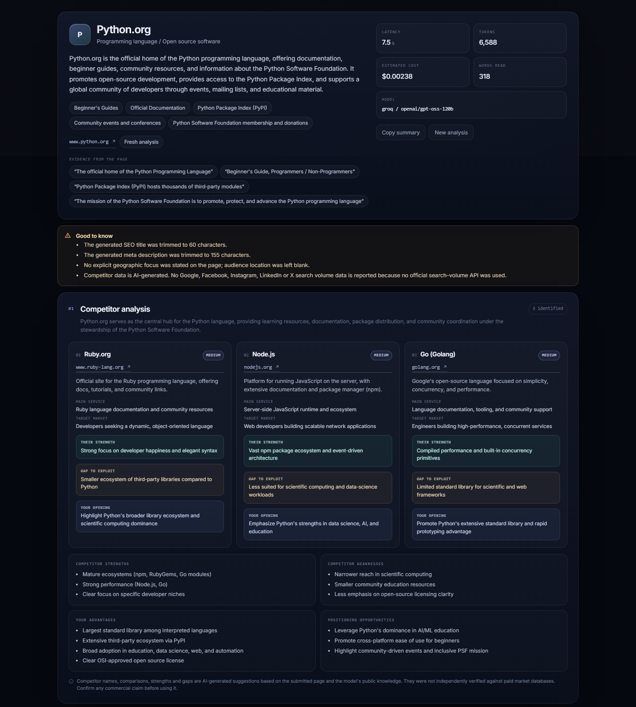
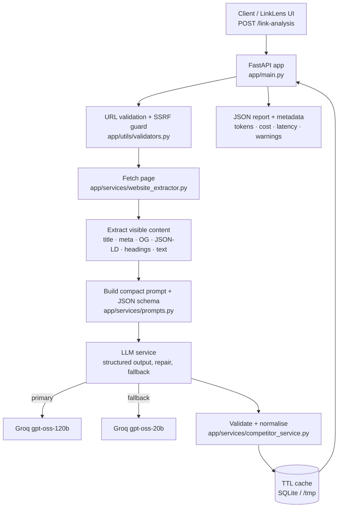

# AI-Powered Website Link Analysis API

A FastAPI service that fetches a public website, extracts its visible content with
SSRF protections, and uses a structured-output LLM to return five business insights.

**Live demo:** https://ai-link-analysis-nine.vercel.app · **API docs:** [/docs](https://ai-link-analysis-nine.vercel.app/docs) · **GitHub:** https://github.com/dipeshkumar123/ai-link-analysis

The repository also ships **LinkLens**, a dependency-free single-page frontend served at
`/`. Paste a URL and the page renders the validated JSON as a readable report.

[](https://ai-link-analysis-nine.vercel.app)



---

## What it returns

Every successful analysis has five sections:

| Section | Contents |
| --- | --- |
| **Competitor analysis** | AI-generated competitor suggestions with strengths, weaknesses, positioning opportunities and a disclaimer |
| **Target search queries** | Five buyer-intent queries, each mapped to Google, Facebook, Instagram, LinkedIn and/or X |
| **SEO improvements** | Primary, secondary, long-tail and business keywords; title/meta suggestions; supporting content and on-page fixes |
| **Top services** | Services stated on the page plus services clearly labelled as inferred |
| **Target audience** | Primary/secondary segments, industries, customer needs, challenges and recommended segments |

The API does **not** invent Google/Facebook/Instagram/LinkedIn/X search volumes. It
returns no volume data and states this in the response warnings.

---

## Architecture



The pipeline is deliberately linear: validate, fetch, extract, prompt, call, validate,
cache, return. The LLM is the only external dependency and is wrapped with schema
enforcement, one optional repair pass and a configured fallback.

---

## Quick start

Requirements: Python 3.11+ (tested on 3.13) and a Groq API key.

```powershell
python -m venv .venv
.\.venv\Scripts\Activate.ps1
pip install -r requirements.txt
Copy-Item .env.example .env        # then set GROQ_API_KEY=...
uvicorn app.main:app --host 0.0.0.0 --port 4000
```

Open http://127.0.0.1:4000 for the web app, or http://127.0.0.1:4000/docs for Swagger UI.

```powershell
$body = '{"url":"https://www.python.org/about/"}'
Invoke-RestMethod -Uri http://127.0.0.1:4000/link-analysis -Method Post `
  -ContentType 'application/json' -Body $body
```

A real response is in [`samples/response.json`](samples/response.json); a sample error is
in [`samples/error.json`](samples/error.json); a captured run log is in
[`docs/sample-run.txt`](docs/sample-run.txt).

---

## API

### `POST /link-analysis`

Request:

```json
{ "url": "https://www.python.org/about/" }
```

Response (abridged — see `samples/response.json` for the full object):

```json
{
  "success": true,
  "request_id": "d35b9a67db0e4d409108f4503153f9a2",
  "website": "https://www.python.org/about/",
  "brand": {
    "name": "Python.org",
    "category": "Programming language community / Open source software",
    "summary": "Python.org is the official home of the Python programming language...",
    "website": "https://www.python.org",
    "main_offerings": ["Beginner's Guides", "Official Documentation"],
    "target_market": null,
    "evidence": ["The official home of the Python Programming Language"]
  },
  "analysis": {
    "competitor_analysis": {
      "main_category": "Open source software",
      "competitors": [
        {
          "brand_name": "Ruby.org",
          "website": null,
          "main_service": "Ruby language documentation",
          "key_strength": "...",
          "weakness_or_gap": "...",
          "opportunity_for_your_brand": "...",
          "source": "AI-generated suggestion",
          "confidence": "medium"
        }
      ],
      "competitor_strengths": ["..."],
      "competitor_weaknesses": ["..."],
      "competitive_advantages": ["..."],
      "market_positioning_opportunities": ["..."],
      "disclaimer": "Competitor names, comparisons, strengths and gaps are AI-generated..."
    },
    "target_search_queries": [
      {
        "query": "how to learn Python for beginners",
        "platforms": ["Google"],
        "intent": "informational",
        "business_relevance": "...",
        "target_audience": "..."
      }
    ],
    "seo_improvements": {
      "primary_keyword": "Python programming language",
      "secondary_keywords": ["..."],
      "long_tail_keywords": ["..."],
      "business_keywords": ["..."],
      "recommended_title": "Python Programming Language - Docs, Tutorials, Community",
      "title_rationale": "...",
      "meta_description": "...",
      "supporting_content": [
        { "content_type": "...", "title": "...", "description": "...", "priority": "high" }
      ],
      "on_page_fixes": ["..."]
    },
    "top_services": [
      {
        "service_name": "Official Documentation",
        "description": "...",
        "target_industry": "...",
        "target_customer": "...",
        "main_benefit": "...",
        "source": "website",
        "evidence": "..."
      }
    ],
    "target_audience": {
      "primary_audience": [
        {
          "audience": "Novice programmers",
          "business_type": "...",
          "requirement": "...",
          "customer_needs": "...",
          "why_fit": "..."
        }
      ],
      "secondary_audience": ["..."],
      "industries": ["..."],
      "customer_profiles": ["..."],
      "location_focus": null,
      "customer_needs": ["..."],
      "customer_challenges": ["..."],
      "recommended_segments": ["..."]
    }
  },
  "metadata": {
    "extraction": { "status_code": 200, "title": "...", "word_count": 318, "truncated": false },
    "llm": {
      "provider": "groq",
      "model": "openai/gpt-oss-120b",
      "input_tokens": 3495,
      "output_tokens": 3093,
      "total_tokens": 6588,
      "estimated_cost_usd": 0.00238005,
      "latency_ms": 7503,
      "cached": false,
      "fallback_used": false,
      "repair_attempts": 0
    }
  },
  "warnings": [
    "Competitor data is AI-generated. No search-volume data is reported."
  ]
}
```

### Endpoints

| Method | Path | Purpose |
| --- | --- | --- |
| `POST` | `/link-analysis` | Main analysis endpoint |
| `GET` | `/` | LinkLens web UI |
| `GET` | `/api` | Service metadata (JSON) |
| `GET` | `/health` | Health/readiness and active LLM configuration |
| `GET` | `/docs` | Swagger UI |
| `GET` | `/redoc` | ReDoc |
| `GET` | `/openapi.json` | OpenAPI schema |

### Error format

All errors share one shape:

```json
{
  "success": false,
  "request_id": "5df79dfdc6e9416da5adc0188ec44c81",
  "error": {
    "code": "blocked_ip",
    "message": "Private, loopback, link-local and reserved IP addresses are not allowed.",
    "details": null
  }
}
```

Common codes: `invalid_request`, `invalid_url`, `unsupported_scheme`,
`credentials_not_allowed`, `blocked_host`, `blocked_ip`, `dns_error`,
`insufficient_content`, `website_timeout`, `llm_error`, `llm_invalid_output`,
`rate_limited`.

---

## How it works

1. **Validate the URL** — structure checks, scheme allow-list, credential rejection,
   hostname normalisation, DNS resolution and private/reserved IP blocking. Redirect
   targets are re-validated on every hop.
2. **Fetch the page** — a browser-like User-Agent avoids common Cloudflare blocks;
   content type, byte size and redirect count are bounded.
3. **Extract evidence** — BeautifulSoup with `lxml` (fallback `html.parser`) pulls
   title, meta description, canonical URL, Open Graph data, JSON-LD, headings,
   navigation labels, image alt text and main visible text. Scripts and styles are
   stripped.
4. **Build a compact prompt** — extraction output is truncated to `MAX_INPUT_CHARS` and
   sent with a strict JSON schema and a system prompt that forbids invented volumes.
5. **Call the LLM** — the primary provider runs first; on a schema rejection or invalid
   JSON the service can repair once, then try the configured fallback provider/model.
6. **Validate and normalise** — Pydantic validation, own-brand removal from competitors,
   de-duplication, SEO trimming, inferred-service labelling and transparency warnings.
7. **Cache and return** — responses are cached for `CACHE_TTL_SECONDS` (SQLite locally,
   `/tmp` on Vercel) and include extraction metadata, tokens, cost, latency and flags.

### Provider adapters

Implemented in `app/services/llm_service.py`:

- OpenAI-compatible: Groq, OpenAI, DeepSeek, OpenRouter, Ollama.
- Native Gemini (`responseMimeType=application/json` + schema).
- Native Anthropic Messages API with tool-style structured output.

Only Groq was live-tested because it was the only key available; the other adapters are
implemented but untested here.

---

## LLM research and cost

Full comparison, sources and measured latency: [`docs/LLM_RESEARCH.md`](docs/LLM_RESEARCH.md).

| Provider / model | Input $/1M | Output $/1M | Structured JSON | Notes |
| --- | ---: | ---: | --- | --- |
| Groq `openai/gpt-oss-120b` | 0.15 | 0.60 | strict schema | **Primary**; free tier observed 8k TPM |
| Groq `openai/gpt-oss-20b` | 0.075 | 0.30 | strict schema | **Fallback** |
| Gemini 3.5 Flash-Lite | 0.30 | 2.50 | JSON schema | Strong production alternative; no key |
| Anthropic Claude Haiku 5.5 | 0.10 | 0.50 | JSON schema | Strong quality/cost alternative; no key |
| OpenAI GPT-6 Luna | 0.10 | 0.50 | Structured Outputs | No key |
| DeepSeek Flash | 0.15 | 0.60 | JSON mode | Off-peak pricing; no key |

Prices are list prices verified on 2026-11-23 and may change. The live Groq run used
6,588 tokens for a 318-word page and estimated **$0.00238** per analysis.

**Token budget.** Groq's free tier was observed at **8,000 tokens/minute** for
`gpt-oss-120b`, and a request counts prompt tokens plus `max_tokens`. Defaults stay
under that: `MAX_INPUT_CHARS=6500`, `LLM_MAX_OUTPUT_TOKENS=3500`. Raising either requires
a larger tier or will trigger 429s.

---

## Configuration

Copy `.env.example` to `.env`. Key values:

| Variable | Default | Purpose |
| --- | --- | --- |
| `LLM_PROVIDER` | `groq` | `groq`, `openai`, `gemini`, `anthropic`, `deepseek`, `openrouter`, `ollama` |
| `LLM_MODEL` | `openai/gpt-oss-120b` | Primary model |
| `LLM_FALLBACK_MODEL` | `openai/gpt-oss-20b` | Optional fallback model |
| `GROQ_API_KEY` | empty | Groq API key |
| `LLM_MAX_OUTPUT_TOKENS` | `3500` | Output cap; counts toward provider TPM |
| `MAX_INPUT_CHARS` | `6500` | Prompt context cap |
| `LLM_TIMEOUT_SECONDS` | `90` | LLM request timeout |
| `FETCH_TIMEOUT_SECONDS` | `15` | Website fetch timeout |
| `MAX_PAGE_BYTES` | `2000000` | Download limit |
| `MAX_REDIRECTS` | `5` | Redirect limit |
| `RATE_LIMIT_PER_HOUR` | `60` | Per-IP sliding window (in-process) |
| `CACHE_ENABLED` | `true` | SQLite/TTL response cache |
| `CACHE_TTL_SECONDS` | `86400` | Cache lifetime |
| `ALLOW_PRIVATE_HOSTS` | `false` | Keep false in production |

The full list is in `.env.example` and `app/config.py`.

---

## Testing

```powershell
pip install -r requirements-dev.txt
ruff check .
pytest -q
```

The suite covers URL validation/SSRF, HTML extraction, JSON parsing and validation,
competitor normalisation, cache TTL, the API success path, invalid URLs, website
failures, LLM failures, rate limiting and health/docs endpoints. Tests mock the LLM and
never call a provider.

Current result: **42 passed**, Ruff clean.

---

## Deployment

**Docker**

```powershell
docker build -t ai-link-analysis .
docker run --rm -p 4000:4000 --env-file .env ai-link-analysis
```

The image runs as a non-root user and exposes a `/health` check.

**Vercel** — the repo has a root `main.py` entrypoint for the Python framework preset.

```powershell
npm install -g vercel
vercel login
vercel --prod --yes
```

Set `LLM_PROVIDER`, `LLM_MODEL`, `LLM_FALLBACK_MODEL`, `GROQ_API_KEY`,
`MAX_INPUT_CHARS`, `LLM_MAX_OUTPUT_TOKENS`, `CACHE_ENABLED` and `RATE_LIMIT_PER_HOUR` in
the project (or via `vercel env add`). The function has a 300s ceiling and normally
returns in under 15s; the cache uses `/tmp` when `VERCEL` is set. Production alias:
https://ai-link-analysis-nine.vercel.app.

---

## Project structure

```text
ai-link-analysis/
├── app/
│   ├── main.py                  # FastAPI app, middleware, error handlers
│   ├── config.py                # settings and pricing table
│   ├── schemas.py               # request/response and LLM payload models
│   ├── exceptions.py            # AppError
│   ├── static/index.html        # LinkLens single-page frontend (no build step)
│   ├── services/
│   │   ├── analysis_service.py  # orchestration and caching
│   │   ├── website_extractor.py # fetching, parsing, SSRF-safe redirects
│   │   ├── prompts.py           # system prompt, JSON schema, repair prompt
│   │   ├── llm_service.py       # multi-provider structured output
│   │   ├── competitor_service.py# normalisation and safety labels
│   │   └── cache.py             # SQLite/TTL cache
│   └── utils/
│       ├── validators.py        # URL + SSRF validation
│       ├── text.py
│       └── logging.py
├── docs/                        # screenshots, LLM research, sample run
├── samples/                     # request.json, response.json, error.json
├── scripts/analyze_url.py       # CLI helper
├── tests/
├── main.py                      # Vercel entrypoint
├── Dockerfile · vercel.json · requirements*.txt · .env.example
```

---

## Security and responsible AI

- **SSRF protection:** only `http`/`https`, no credentials, no localhost/private/
  reserved IPs, DNS resolution checked, every redirect re-validated.
- **No secrets in logs:** API keys are never logged; `.env` is gitignored.
- **Rate limiting:** per-IP sliding window, configurable.
- **Input limits:** URL length, page bytes, redirects, prompt context and output tokens
  are all bounded.
- **No invented search volumes:** the schema has no volume field and the prompt forbids
  volume claims.
- **Competitor data is labelled:** AI-generated suggestions, not verified market data;
  placeholders and warnings appear when confidence is low.
- **Inferred services are labelled:** `source` is `website` or `inferred`.
- **Transparency metadata:** tokens, cost, latency, fallback and repair attempts are
  returned in every response.

### Known limitations

- The free Groq tier is rate-limited (observed 8,000 TPM); high traffic needs a paid
  tier or another provider.
- Only Groq was live-tested; the other adapters need their own keys and a smoke test.
- JavaScript-rendered or bot-blocked sites can yield little text; the response warns.
- Competitor names and comparisons are model suggestions and must be verified before
  commercial use.
- Pricing and model availability change; check provider docs before production.

---

Built by **Dipesh Kumar Panjiyar**.
