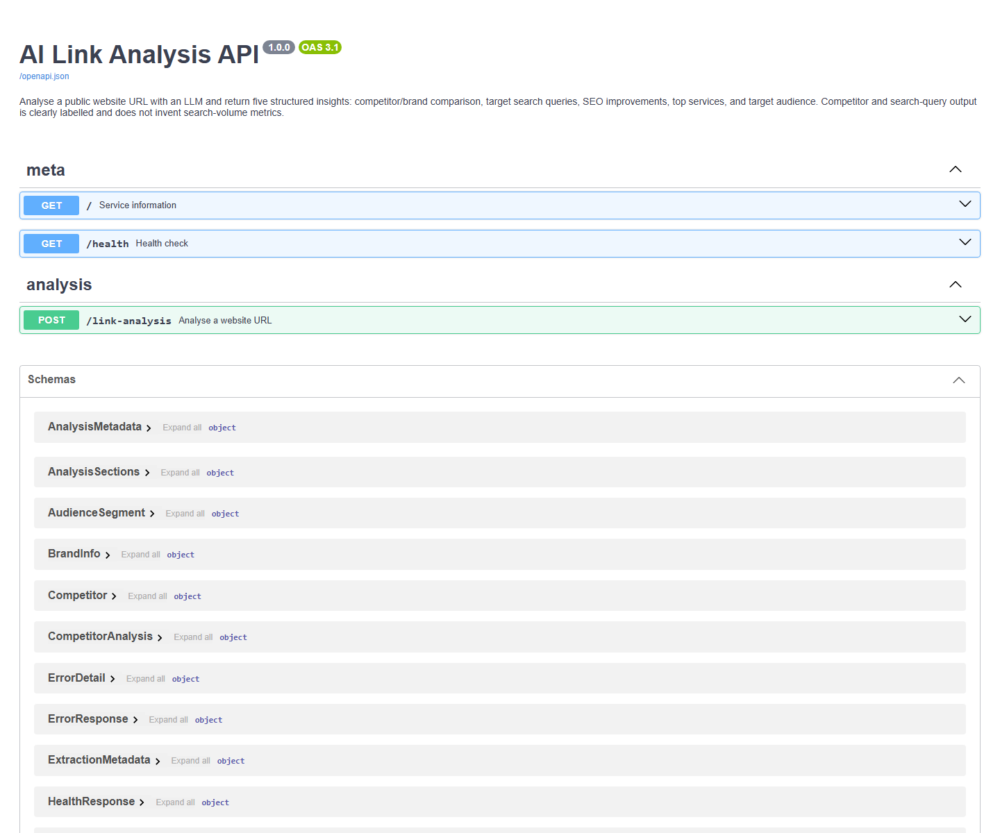

# AI-Powered Website Link Analysis API

A FastAPI service that fetches a public website, extracts its visible content with
SSRF protections, and uses a structured-output LLM to return five business insights:

1. **Competitor analysis** — clearly labelled AI-generated competitor suggestions,
   strengths, weaknesses and positioning opportunities.
2. **Target search queries** — platform-tagged query ideas with intent and relevance.
3. **SEO improvements** — primary/secondary/long-tail keywords, title and meta
   suggestions, supporting content and on-page fixes.
4. **Top services** — services stated on the page plus clearly labelled inferred
   services.
5. **Target audience** — primary/secondary segments, industries, needs, challenges
   and recommended segments.

The API does **not** invent Google/Facebook/Instagram/LinkedIn/X search volumes. It
returns `null`/no volume data and states this in the response warnings.

**Live demo:** https://ai-link-analysis-nine.vercel.app
**Interactive docs:** https://ai-link-analysis-nine.vercel.app/docs
**GitHub:** https://github.com/dipeshkumar123/ai-link-analysis



---

## Quick start

Requirements: Python 3.11+ (developed and tested on 3.13), a Groq API key, and a
local Python environment with the packages from `requirements.txt`.

```powershell
cd D:\Projects\ai-link-analysis
python -m venv .venv
.\.venv\Scripts\Activate.ps1
pip install -r requirements.txt
Copy-Item .env.example .env
# Edit .env and set GROQ_API_KEY=...
uvicorn app.main:app --host 0.0.0.0 --port 4000
```

Open http://127.0.0.1:4000/docs for Swagger UI.

### Test a request

```powershell
$body = '{"url":"https://www.python.org/about/"}'
Invoke-RestMethod -Uri http://127.0.0.1:4000/link-analysis `
  -Method Post -ContentType 'application/json' -Body $body
```

A real sample response is in [`samples/response.json`](samples/response.json) and a
sample invalid-URL error is in [`samples/error.json`](samples/error.json).

---

## API

### `POST /link-analysis`

Request:

```json
{ "url": "https://www.python.org/about/" }
```

Response (abridged; see `samples/response.json` for the full object):

```json
{
  "success": true,
  "request_id": "d35b9a67db0e4d409108f4503153f9a2",
  "website": "https://www.python.org/about/",
  "brand": {
    "name": "Python.org",
    "category": "Programming language community / Open source software",
    "summary": "Python.org is the official home of the Python programming language...",
    "website": "https://www.python.org",
    "main_offerings": ["Beginner's Guides", "Official Documentation", "..."],
    "target_market": null,
    "evidence": ["The official home of the Python Programming Language", "..."]
  },
  "analysis": {
    "competitor_analysis": {
      "brand_overview": "...",
      "main_category": "Open source software",
      "main_products_services": ["..."],
      "competitors": [
        {
          "brand_name": "Ruby.org",
          "website": null,
          "overview": "...",
          "main_service": "Ruby language documentation and community resources",
          "target_market": "...",
          "key_strength": "...",
          "weakness_or_gap": "...",
          "opportunity_for_your_brand": "...",
          "source": "AI-generated suggestion",
          "confidence": "medium"
        }
      ],
      "competitor_strengths": ["..."],
      "competitor_weaknesses": ["..."],
      "competitive_advantages": ["..."],
      "market_positioning_opportunities": ["..."],
      "disclaimer": "Competitor names, comparisons, strengths and gaps are AI-generated..."
    },
    "target_search_queries": [
      {
        "query": "how to learn Python for beginners",
        "platforms": ["Google"],
        "intent": "informational",
        "business_relevance": "...",
        "target_audience": "..."
      }
    ],
    "seo_improvements": {
      "primary_keyword": "Python programming language",
      "secondary_keywords": ["..."],
      "long_tail_keywords": ["..."],
      "business_keywords": ["..."],
      "recommended_title": "Python Programming Language - Docs, Tutorials, Community",
      "title_rationale": "...",
      "meta_description": "...",
      "meta_description_rationale": "...",
      "supporting_content": [
        { "content_type": "...", "title": "...", "description": "...", "priority": "high" }
      ],
      "on_page_fixes": ["..."]
    },
    "top_services": [
      {
        "service_name": "Official Documentation",
        "description": "...",
        "target_industry": "...",
        "target_customer": "...",
        "main_benefit": "...",
        "source": "website",
        "evidence": "..."
      }
    ],
    "target_audience": {
      "primary_audience": [
        {
          "audience": "Novice programmers",
          "business_type": "...",
          "requirement": "...",
          "customer_needs": "...",
          "why_fit": "..."
        }
      ],
      "secondary_audience": ["..."],
      "industries": ["..."],
      "business_types": ["..."],
      "customer_profiles": ["..."],
      "location_focus": null,
      "customer_needs": ["..."],
      "customer_challenges": ["..."],
      "interests": ["..."],
      "recommended_segments": ["..."]
    }
  },
  "metadata": {
    "extraction": {
      "requested_url": "https://www.python.org/about/",
      "final_url": "https://www.python.org/about/",
      "status_code": 200,
      "title": "About Python | Python.org",
      "meta_description": "The official home of the Python Programming Language",
      "word_count": 318,
      "content_chars": 2156,
      "truncated": false,
      "fetched_at": "2026-11-23T07:39:15.523291Z",
      "warnings": []
    },
    "llm": {
      "provider": "groq",
      "model": "openai/gpt-oss-120b",
      "input_tokens": 3495,
      "output_tokens": 3093,
      "total_tokens": 6588,
      "estimated_cost_usd": 0.00238005,
      "pricing_source": "https://console.groq.com/docs/models",
      "pricing_note": "Free tier observed at 8,000 tokens/minute and 1,000 requests/day on 2026-11-23.",
      "latency_ms": 7503,
      "cached": false,
      "fallback_used": false,
      "repair_attempts": 0,
      "token_usage_estimated": false
    }
  },
  "warnings": [
    "The generated SEO title was trimmed to 60 characters.",
    "No explicit geographic focus was stated on the page; audience location was left blank.",
    "Competitor data is AI-generated. No Google, Facebook, Instagram, LinkedIn or X search volume data is reported because no official search-volume API was used."
  ]
}
```

### Other endpoints

| Method | Path | Purpose |
| --- | --- | --- |
| `GET` | `/` | Service metadata |
| `GET` | `/health` | Health/readiness and active LLM configuration |
| `GET` | `/docs` | Swagger UI |
| `GET` | `/redoc` | ReDoc |
| `GET` | `/openapi.json` | OpenAPI schema |
| `POST` | `/link-analysis` | Main analysis endpoint |

### Error format

All errors use the same shape:

```json
{
  "success": false,
  "request_id": "5df79dfdc6e9416da5adc0188ec44c81",
  "error": {
    "code": "blocked_ip",
    "message": "Private, loopback, link-local and reserved IP addresses are not allowed.",
    "details": null
  }
}
```

Common codes: `invalid_request`, `invalid_url`, `unsupported_scheme`,
`credentials_not_allowed`, `blocked_host`, `blocked_ip`, `dns_error`,
`insufficient_content`, `website_timeout`, `llm_error`, `llm_invalid_output`,
`rate_limited`.

---

## How it works

1. **Validate the URL.** Structure checks, scheme allow-list, credential rejection,
   hostname normalisation, DNS resolution and private/reserved IP blocking. Redirect
   targets are re-validated on every hop.
2. **Fetch the page.** A browser-like User-Agent is used (some sites return Cloudflare
   403 to generic library agents). Content type, byte size and redirect count are
   bounded.
3. **Extract evidence.** BeautifulSoup with `lxml` (fallback `html.parser`) extracts
   title, meta description, canonical URL, Open Graph data, JSON-LD, headings,
   navigation link labels, image alt text and the main visible text. Scripts and
   styles are removed before text extraction.
4. **Build a compact prompt.** The extractor output is truncated to
   `MAX_INPUT_CHARS` and sent with a strict JSON schema and a system prompt that
   forbids invented search volumes.
5. **Call the LLM.** The primary provider is called first. If the provider rejects
   the schema or returns invalid JSON, the service can repair once (configurable)
   and then try the configured fallback provider/model.
6. **Validate and normalise.** The JSON is validated with Pydantic. The service
   removes the submitted brand from its own competitor list, deduplicates lists,
   trims SEO titles/meta, labels inferred services, and adds transparency warnings.
7. **Cache and return.** Successful responses are cached for `CACHE_TTL_SECONDS`
   (SQLite locally, `/tmp` on Vercel). The response includes extraction metadata,
   token counts, estimated cost, latency, fallback/repair flags and warnings.

### Provider adapters

Implemented in `app/services/llm_service.py`:

- OpenAI-compatible: Groq, OpenAI, DeepSeek, OpenRouter, Ollama.
- Native Gemini (`responseMimeType=application/json` + schema).
- Native Anthropic Messages API with tool-style structured output.

The active provider is selected with `LLM_PROVIDER`. Only Groq was live-tested for
this submission because it was the only key available; the other adapters are
implemented but untested here.

---

## LLM research and cost

See [`docs/LLM_RESEARCH.md`](docs/LLM_RESEARCH.md) for the full comparison, sources,
measured latency, token budget and the final provider choice.

Summary:

| Provider / model | Input $/1M | Output $/1M | Context | Structured JSON | Notes |
| --- | ---: | ---: | ---: | --- | --- |
| Groq `openai/gpt-oss-120b` | 0.15 | 0.60 | 131,072 | strict schema | Primary; ~500 tok/s; free tier observed 8k TPM |
| Groq `openai/gpt-oss-20b` | 0.075 | 0.30 | 131,072 | strict schema | Fallback; ~1,000 tok/s |
| Groq `qwen/qwen3.8-27b` | 0.80 | 4.00 | 131,072 | JSON mode | Rejected as fallback: 1,000 output-token/min limit observed |
| Gemini 3.5 Flash-Lite | 0.30 | 2.50 | 1,048,576 | JSON schema | Strong production alternative; no key available |
| Anthropic Claude Haiku 5.5 | 0.10 | 0.50 | 1,000,000 | JSON schema | Strong quality/cost alternative; no key available |
| OpenAI GPT-6 Luna | 0.10 | 0.50 | 1,050,000 | Structured Outputs | No key available |
| DeepSeek Flash | 0.15 | 0.60 | 1,000,000 | JSON mode | Off-peak pricing; no key available |

Prices are list prices verified on 2026-11-23 and can change. The live Groq run used
6,588 tokens for a 318-word page and estimated **$0.00238** per analysis.

### Token budget

Groq's free tier was observed at **8,000 tokens/minute** for `gpt-oss-120b`. A request
counts prompt tokens plus `max_tokens`, so the defaults are deliberately bounded:

- `MAX_INPUT_CHARS=6500` (roughly 2,000–2,500 tokens of page context)
- `LLM_MAX_OUTPUT_TOKENS=3500`
- system prompt and schema add roughly 1,000–1,500 tokens

The observed request was 3,495 input + 3,093 output = **6,588 tokens**, leaving
headroom under 8,000. If you increase `MAX_INPUT_CHARS` or `LLM_MAX_OUTPUT_TOKENS`,
increase the Groq tier or expect 429s.

---

## Configuration

Copy `.env.example` to `.env`. The most important values:

| Variable | Default | Purpose |
| --- | --- | --- |
| `LLM_PROVIDER` | `groq` | `groq`, `openai`, `gemini`, `anthropic`, `deepseek`, `openrouter`, `ollama` |
| `LLM_MODEL` | `openai/gpt-oss-120b` | Primary model |
| `LLM_FALLBACK_PROVIDER` | `groq` | Optional fallback |
| `LLM_FALLBACK_MODEL` | `openai/gpt-oss-20b` | Optional fallback model |
| `GROQ_API_KEY` | empty | Groq API key |
| `LLM_MAX_OUTPUT_TOKENS` | `3500` | Output cap; counts toward provider TPM |
| `MAX_INPUT_CHARS` | `6500` | Prompt context cap |
| `LLM_TIMEOUT_SECONDS` | `90` | LLM request timeout |
| `FETCH_TIMEOUT_SECONDS` | `15` | Website fetch timeout |
| `MAX_PAGE_BYTES` | `2000000` | Download limit |
| `MAX_REDIRECTS` | `5` | Redirect limit |
| `RATE_LIMIT_PER_HOUR` | `60` | Per-IP limit (in-process) |
| `CACHE_ENABLED` | `true` | SQLite/TTL response cache |
| `CACHE_TTL_SECONDS` | `86400` | Cache lifetime |
| `ALLOW_PRIVATE_HOSTS` | `false` | Keep false in production |

The full list is in `.env.example` and `app/config.py`.

---

## Testing

```powershell
pip install -r requirements-dev.txt
ruff check .
pytest -q
```

The suite covers URL validation/SSRF, HTML extraction, JSON parsing and validation,
competitor normalisation, cache TTL, the API success path, invalid URLs, website
failures, LLM failures, rate limiting and health/docs endpoints. Tests mock the LLM
and never call a provider.

Current result: **41 passed**.

---

## Docker

```powershell
docker build -t ai-link-analysis .
docker run --rm -p 4000:4000 --env-file .env ai-link-analysis
```

The image runs as a non-root user and exposes a `/health` check.

---

## Deploy to Vercel

The repository includes a root `main.py` so Vercel's Python framework preset can
serve the ASGI app directly.

```powershell
npm install -g vercel
vercel login
vercel --prod --yes
```

Set the environment variables in the Vercel project (or via `vercel env add`):

```text
LLM_PROVIDER=groq
LLM_MODEL=openai/gpt-oss-120b
LLM_FALLBACK_PROVIDER=groq
LLM_FALLBACK_MODEL=openai/gpt-oss-20b
GROQ_API_KEY=...
MAX_INPUT_CHARS=6500
LLM_MAX_OUTPUT_TOKENS=3500
CACHE_ENABLED=true
RATE_LIMIT_PER_HOUR=60
```

Vercel Hobby has a 300-second function limit; this API normally returns in under
15 seconds. The cache uses `/tmp` when the `VERCEL` environment variable is set.

After deployment, update the live URL at the top of this README and submit it with
the application.

---

## Project structure

```text
ai-link-analysis/
├── app/
│   ├── main.py                  # FastAPI app, middleware, error handlers
│   ├── config.py                # settings and pricing table
│   ├── schemas.py               # request/response and LLM payload models
│   ├── exceptions.py            # AppError
│   ├── services/
│   │   ├── analysis_service.py  # orchestration and caching
│   │   ├── website_extractor.py # fetching, parsing, SSRF-safe redirects
│   │   ├── prompts.py           # system prompt, JSON schema, repair prompt
│   │   ├── llm_service.py       # multi-provider structured output
│   │   ├── competitor_service.py# normalisation and safety labels
│   │   └── cache.py             # SQLite/TTL cache
│   └── utils/
│       ├── validators.py        # URL + SSRF validation
│       ├── text.py
│       └── logging.py
├── docs/
│   ├── LLM_RESEARCH.md
│   └── sample-run.txt
├── samples/
│   ├── request.json
│   ├── response.json
│   └── error.json
├── scripts/
│   └── analyze_url.py
├── tests/
├── .env.example
├── Dockerfile
├── main.py                      # Vercel entrypoint
├── requirements.txt
├── requirements-dev.txt
└── vercel.json
```

---

## Security and responsible AI

- **SSRF protection:** only `http`/`https`, no credentials, no localhost/private/
  reserved IPs, DNS resolution checked, and every redirect re-validated.
- **No secrets in logs:** API keys are never logged; `.env` is gitignored.
- **Rate limiting:** per-IP sliding window; configurable.
- **Input limits:** URL length, page bytes, redirect count, prompt context and
  output tokens are all bounded.
- **No invented search volumes:** the schema has no volume field and the prompt
  forbids volume claims.
- **Competitor data is labelled:** competitors are AI-generated suggestions, not
  verified market data. If the model cannot identify three competitors, the response
  includes clearly labelled `Unverified competitor candidate` placeholders and a
  warning.
- **Inferred services are labelled:** `source` is `website` or `inferred`.
- **Transparency metadata:** token usage, estimated cost, latency, fallback and
  repair attempts are returned in every response.

### Known limitations

- The free Groq tier is rate-limited (observed 8,000 TPM); high traffic needs a paid
  tier or a different provider.
- Only Groq was live-tested. Gemini/OpenAI/Anthropic/DeepSeek adapters are implemented
  but need their own keys and a smoke test.
- Some sites are JavaScript-rendered or bot-blocked; extraction can return little
  text. The response warns when this happens.
- Competitor names and comparisons are model suggestions and must be verified before
  commercial use.
- Pricing and model availability change; check the provider docs before production.

---

## Submission checklist

- [x] Public GitHub repository
- [x] `POST /link-analysis` on port 4000 locally
- [x] Five structured sections
- [x] Groq structured output verified end-to-end
- [x] SSRF protection and URL validation
- [x] Tests and lint passing
- [x] README, samples and LLM research
- [x] Docker and Vercel deployment files
- [x] Live demo deployed at https://ai-link-analysis-nine.vercel.app
- [ ] Submission email sent to `hr@chivoxai.com`
- [ ] Dxora LinkedIn and CREST Instagram followed (manual step)

---

Built by **Dipesh Kumar Panjiyar**.